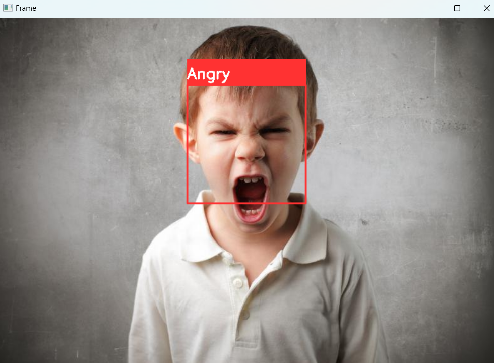
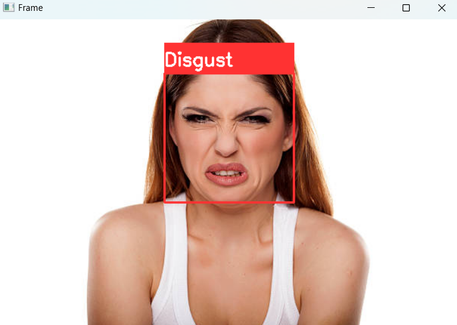
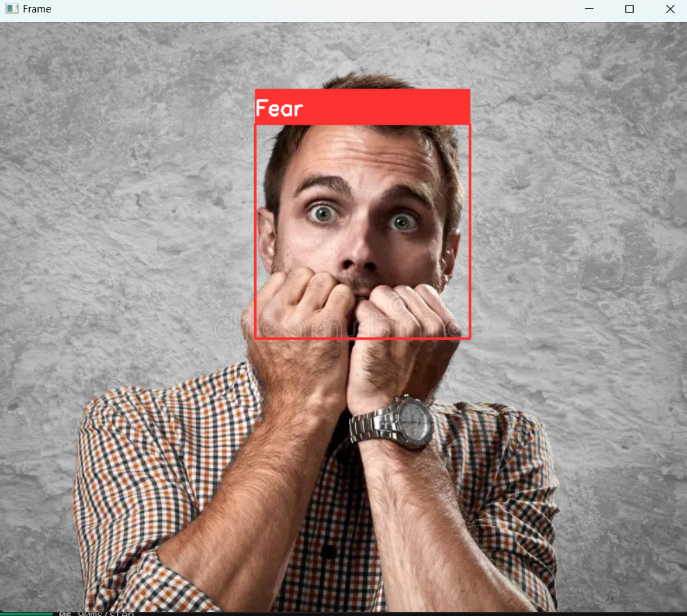
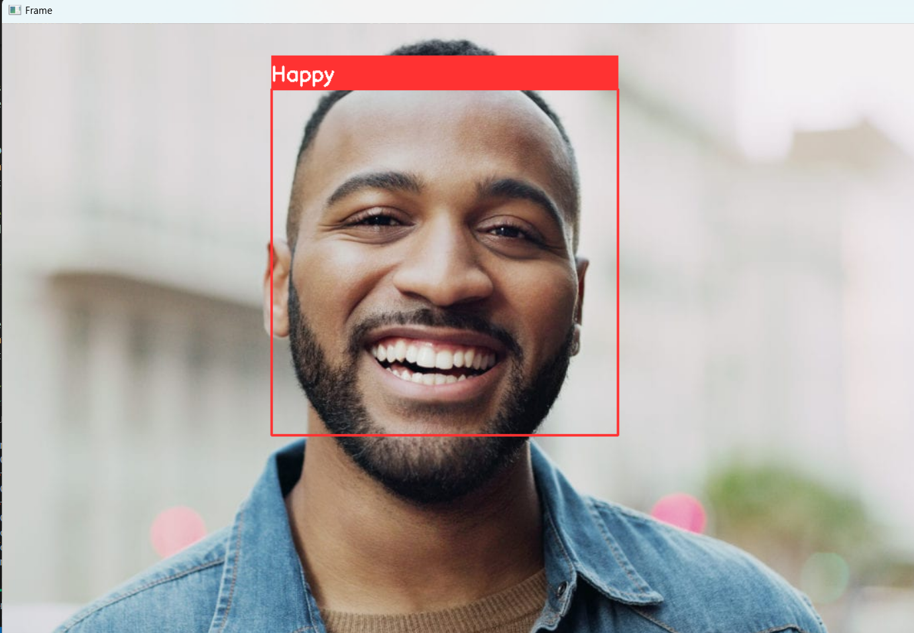
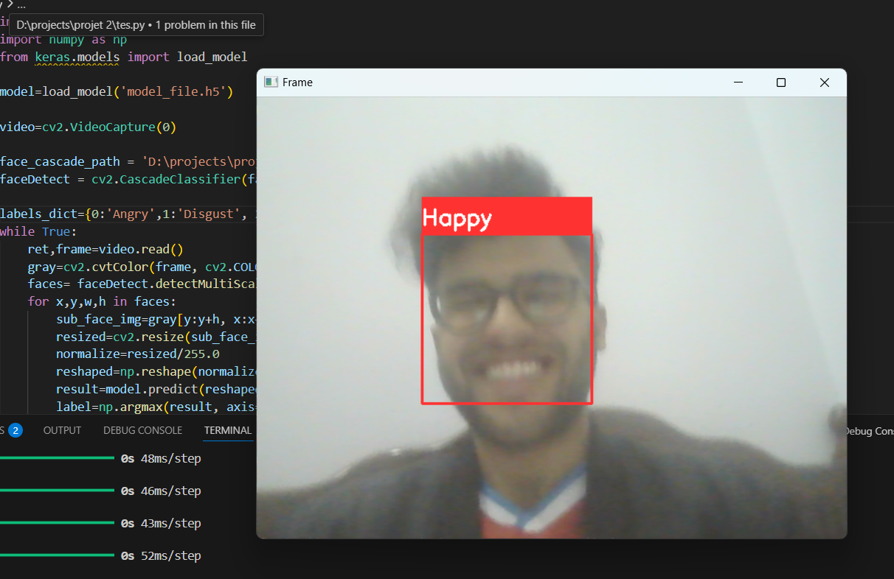
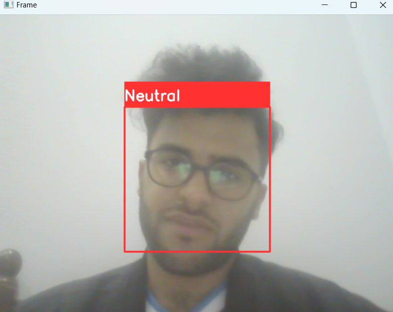
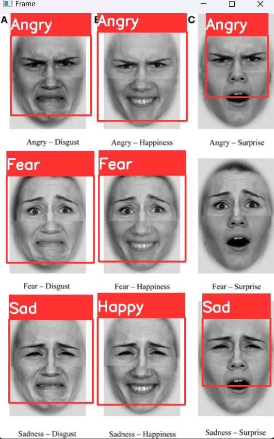
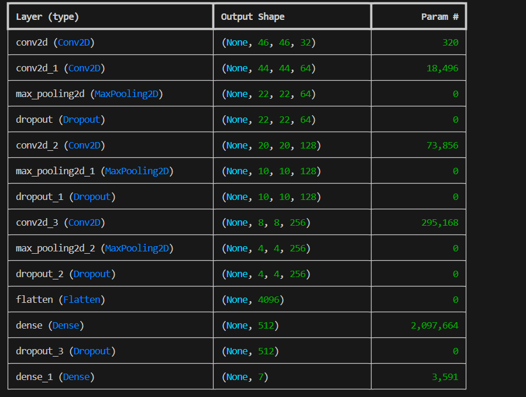

# Real-Time Facial Emotion Recognition

A CNN-based system that detects faces in video streams and classifies their
emotional expressions in real time. Trained on the **FER2013** dataset (7
emotion classes, ~35k images), the model achieves **~62% validation accuracy**
using a lightweight 4-layer convolutional architecture.

## Demo

### Static Image Detection

| Angry | Disgust | Fear | Happy |
|:-----:|:-------:|:----:|:-----:|
|  |  |  |  |

### Real-Time Webcam Detection

| Happy | Neutral |
|:-----:|:-------:|
|  |  |

### Multi-Face Detection



## Architecture

The CNN has 4 convolutional blocks with increasing depth, followed by a
fully-connected classifier:

```
Input (48×48×1 grayscale)
    │
    ├── Conv2D(32, 3×3, ReLU)             →  46×46×32     (320 params)
    │
    ├── Conv2D(64, 3×3, ReLU)             →  44×44×64     (18,496 params)
    ├── MaxPooling2D(2×2)                 →  22×22×64
    ├── Dropout(0.1)
    │
    ├── Conv2D(128, 3×3, ReLU)            →  20×20×128    (73,856 params)
    ├── MaxPooling2D(2×2)                 →  10×10×128
    ├── Dropout(0.1)
    │
    ├── Conv2D(256, 3×3, ReLU)            →  8×8×256      (295,168 params)
    ├── MaxPooling2D(2×2)                 →  4×4×256
    ├── Dropout(0.1)
    │
    ├── Flatten                           →  4096
    ├── Dense(512, ReLU)                  →  512          (2,097,664 params)
    ├── Dropout(0.2)
    │
    └── Dense(7, Softmax)                 →  7            (3,591 params)

Total parameters: 2,489,095
```



## Training Results

| Metric | Value |
|--------|-------|
| Dataset | FER2013 (~28.7k train / ~7.2k test) |
| Input size | 48×48 grayscale |
| Epochs trained | 100 |
| Best validation accuracy | **~62%** (epoch 91) |
| Final validation accuracy | 61.6% (epoch 100) |
| Final validation loss | 1.042 |
| Data augmentation | Rotation (±30°), shear (0.3), zoom (0.3), horizontal flip |
| Optimizer | Adam |
| Loss function | Categorical cross-entropy |

**Note:** State-of-the-art on FER2013 is around 73-76% using deeper architectures
(VGG, ResNet) and ensemble methods. Human accuracy on this dataset is estimated
at ~65%, so a simple 4-layer CNN reaching 62% is a reasonable baseline.

## Inference Pipeline

The real-time detection pipeline processes each webcam frame as follows:

1. **Capture** — read a BGR frame from the webcam via OpenCV
2. **Grayscale conversion** — `cv2.cvtColor(frame, COLOR_BGR2GRAY)`
3. **Face detection** — Haar-cascade classifier (`detectMultiScale`) localizes
   face bounding boxes in the grayscale image
4. **Preprocessing** — for each detected face:
   - Crop the face region from the grayscale image
   - Resize to 48×48 pixels (CNN input size)
   - Normalize pixel values to [0, 1]
   - Reshape to `(1, 48, 48, 1)` for batch prediction
5. **Classification** — the CNN predicts a probability distribution over
   7 emotions; `argmax` selects the most likely class
6. **Visualization** — draw bounding box + emotion label on the original frame

## Project Structure

```
emotion-recognition/
├── train.py                # CNN training script with data augmentation
├── detect_realtime.py      # Real-time webcam emotion recognition
├── detect_image.py         # Single-image emotion detection
├── requirements.txt        # Python dependencies
├── .gitignore
├── LICENSE
├── README.md
├── docs/
│   └── PROJECT_EXPLAINED.md    # Detailed code walkthrough + interview Q&A
└── results/
    ├── angry_detection.png
    ├── disgust_detection.png
    ├── fear_detection.png
    ├── happy_detection.png
    ├── happy_webcam.png
    ├── neutral_webcam.png
    └── multi_face_test.png
```

## Getting Started

### Prerequisites

- Python 3.10+
- Webcam (for real-time detection)
- FER2013 dataset (for training only)

### Installation

```bash
git clone https://gitlab.com/mazen-ben-abid/emotion-recognition.git
cd emotion-recognition
pip install -r requirements.txt
```

### Training (optional — requires FER2013 dataset)

Download the [FER2013 dataset](https://www.kaggle.com/datasets/msambare/fer2013)
from Kaggle and extract it into an `archive/` folder:

```
archive/
├── train/
│   ├── angry/
│   ├── disgust/
│   ├── fear/
│   ├── happy/
│   ├── neutral/
│   ├── sad/
│   └── surprise/
└── test/
    ├── angry/
    ├── ...
```

Then run:

```bash
python train.py --data_dir archive --epochs 100 --batch_size 32
```

The script saves the best model (by validation accuracy) to `model_file.keras`
and generates training curves in `results/training_history.png`.

### Real-Time Detection

```bash
python detect_realtime.py --model model_file.keras
```

Press **q** to quit the webcam window.

### Single Image Detection

```bash
python detect_image.py --image path/to/image.jpg --model model_file.keras
python detect_image.py --image path/to/image.jpg --output annotated.jpg
```

## Emotion Classes

| Index | Emotion | Description |
|-------|---------|-------------|
| 0 | Angry | Furrowed brows, tightened lips |
| 1 | Disgust | Wrinkled nose, raised upper lip |
| 2 | Fear | Raised eyebrows, wide eyes |
| 3 | Happy | Smile, raised cheeks |
| 4 | Neutral | Relaxed face, no strong expression |
| 5 | Sad | Drooping mouth corners, lowered brows |
| 6 | Surprise | Raised eyebrows, open mouth |

## Technical Choices

- **Haar cascade over DNN face detector:** chosen for speed — Haar cascade
  runs at 30+ FPS on CPU, while DNN-based detectors (SSD, MTCNN) add latency
  that matters for real-time applications.

- **Simple CNN over pretrained models:** a 4-layer CNN with 2.5M parameters
  trains in ~1 hour on a consumer GPU and runs inference in <5ms per face.
  Transfer learning (VGGFace, ResNet) would improve accuracy but was not
  the focus of this project.

- **Data augmentation:** rotation, shear, zoom, and horizontal flip
  reduce overfitting on the relatively small FER2013 training set
  (~28.7k images).

- **Dropout regularization:** 10% after each pooling layer and 20% before
  the output layer prevent the dense layers from memorizing training samples.

## Stack

Python, TensorFlow/Keras, OpenCV, NumPy, Matplotlib

## Author

**Mazen Ben Abid** — Engineering Student, ENSTAB
